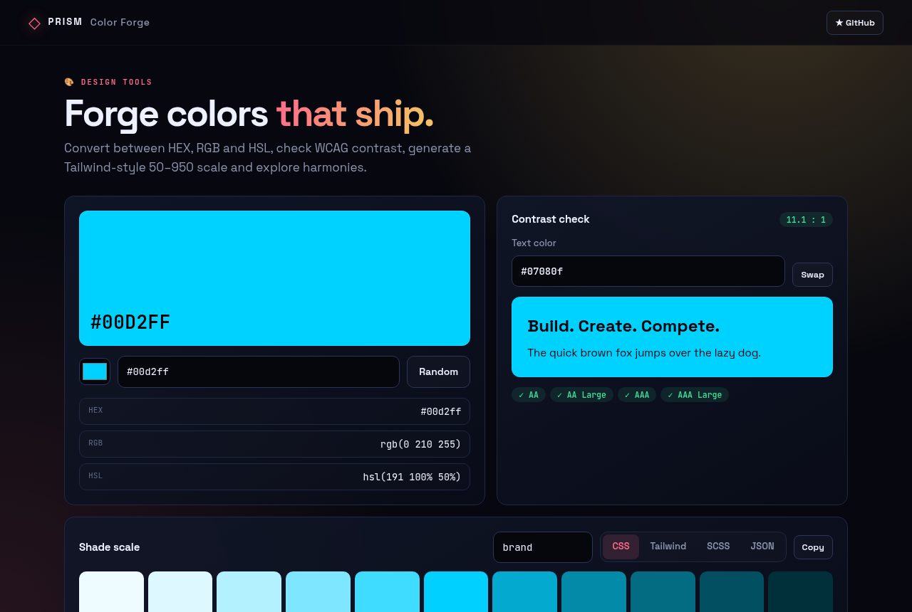
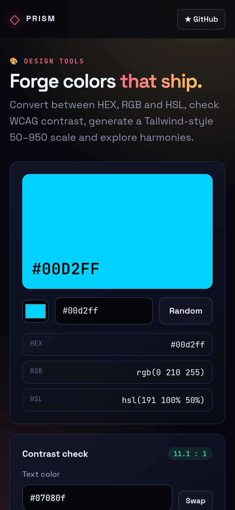

<!-- ═════════════ HEADER ═════════════ -->
<p align="center">
  
</p>

<p align="center">
  
</p>

<p align="center">
  <a href="https://github.com/krishyaa06/prism-color-forge/actions/workflows/ci.yml"></a>
  <a href="https://krishyaa06.github.io/prism-color-forge/"></a>
  
  
  <a href="LICENSE"></a>
</p>

<p align="center">
  
</p>


## ⚡ Overview

**Prism Color Forge** is a color workbench for building UI themes. Pick or paste any color, copy it in every format, check text contrast against WCAG, generate an eleven-step shade scale you can paste straight into Tailwind or CSS variables, and explore complementary, triadic and other harmonies.

## ✨ Features

- **Converter**: HEX, HEX8, `rgb()`, `hsl()` input and output
- **WCAG checker** with AA, AA Large, AAA and live preview
- **Shade scale** 50 → 950 tuned around your base color
- **Export** as CSS variables, Tailwind config, SCSS or JSON
- **Harmonies**: complementary, analogous, triadic, split, tetradic, monochrome
- Click any swatch to copy, `Space` for random, state saved locally

## 📸 Screenshots

<table>
  <tr>
    <td width="68%"></td>
    <td width="32%"></td>
  </tr>
</table>

## 🚀 Quick Start

**Use it online:** [https://krishyaa06.github.io/prism-color-forge/](https://krishyaa06.github.io/prism-color-forge/)

**Run locally:**

```bash
git clone https://github.com/krishyaa06/prism-color-forge.git
cd prism-color-forge
# open index.html in your browser, or serve it:
npx serve .
```

## 🛠️ Usage

- Paste a color like `#6c63ff`, `rgb(108 99 255)` or `hsl(244 100% 69%)`.
- Set a text color to check contrast.
- Name your scale (e.g. `brand`) and switch export tabs to copy CSS or Tailwind config.

## 📁 Project Structure

```
prism-color-forge/
├── assets/
│   ├── logo.png
│   └── logo.svg
├── css/
│   ├── app.css
│   └── prism.css
├── js/
│   ├── app.js   # UI wiring
│   ├── core.js   # color math, contrast and scales — tested in Node
│   └── prism.js
├── test/
│   └── core.test.js
├── .gitignore
├── LICENSE
├── README.md
├── index.html
└── package.json
```

## 🧪 Tests

```bash
npm test
```

Tests use the built-in `node:test` runner, so there is nothing to install. CI runs them on Node 20 and 22.

## 🤝 Contributing

1. Fork the repo and create a branch: `git checkout -b feature/my-idea`
2. Make your change and add a test in `test/`
3. Run `npm test` and open a Pull Request

## 🔷 Part of Prism Protocol

Prism Color Forge is one of the open-source tools built by [Prism Protocol](https://dc.gg/prismprotocol), a tech community where young builders learn, ship and compete together.

## 👤 Author

<table>
  <tr>
    <td align="center">
      <a href="https://github.com/krishyaa06"><br><b>Soumya Bhandare</b></a><br>
      <sub>Founder @ Prism Protocol</sub>
    </td>
    <td>
      <a href="https://dc.gg/prismprotocol"></a><br>
      <a href="https://instagram.com/prism_protocol_"></a><br>
      <a href="https://x.com/krishyaa06"></a>
    </td>
  </tr>
</table>

## 📄 License

Released under the [MIT License](LICENSE).

<p align="center">
  <b>If you like this project, consider giving it a ⭐</b><br>
  <sub>"Build. Create. Compete." · Made with ⚡ by Prism Protocol</sub>
</p>


